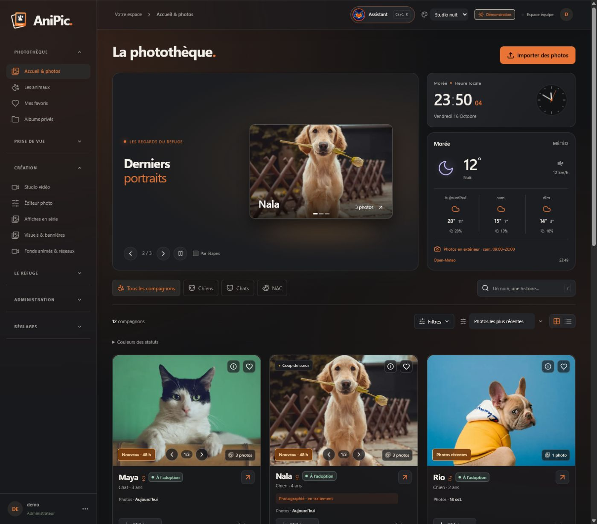

<p align="center">
  <picture>
    <source media="(prefers-color-scheme: dark)" srcset="public/anipic-logo.svg">
    
  </picture>
</p>

<p align="center"><strong>Photothèque, création et outils pour l’équipe du refuge.</strong></p>
<p align="center">React · Tailwind CSS · Fastify · SQLite · Sharp · Remotion · Docker</p>

Anipic reprend le projet GPIC SPA pour organiser les photos des animaux, préparer des publications et des affichettes de box, créer des vidéos et diffuser un programme sur la TV de l’accueil. Les fiches utilisent les identifiants de la SPA : deux animaux portant le même nom gardent chacun leur album.

**Projet vibecodé par [Gaerisson](https://github.com/Gaerisson/), avec Codex, assistant d’OpenAI.** L’idée, les besoins métier, les choix visuels et la direction du projet viennent de Gaerisson.

[Release 3.4](RELEASE_v3.4.md) · [Installation Docker / Portainer](docs/DEPLOIEMENT.md) · [Journal des versions](CHANGELOG.md) · [Tests et validation](VALIDATION.md)



## Présentation

Deux montages de **24,5 secondes**, 30 images/s : portraits en relief et présentation de la photothèque, retouche, affiches, studio et écran TV. Transitions synchronisées sur un extrait de **Borderline — Tame Impala**, fourni pour cette présentation. Le morceau d’origine reste hors du dépôt.

| Story Instagram | Présentation GitHub |
| --- | --- |
| [1080 × 1920 · MP4](docs/media/anipic-presentation-story.mp4) | [1920 × 1080 · MP4](docs/media/anipic-presentation-paysage.mp4) |

[Composition et reproduction du montage](PRESENTATION.md).

## Nouveautés 3.4

Assistant avec chat contextuel, erreurs IA visibles, distinction SPA/local et loader sur les affiches, ouverture du design Canva après import. TV plus fluide avec saisons, particules, horaires en grille et nouvelles animations du logo ; bannières à thème avec sous-titre. Miniatures C8, avatars et dernières connexions, journal horodaté et statistiques photo locales séparées des références SPA. Couvertures d’albums prises dans les sous-dossiers, corbeille des photos d’animaux et [compression NAS après sauvegarde vérifiée](docs/ARCHIVES.md).

**`MAX_MEDIA_MB`** règle la limite audio/vidéo (512 Mo par défaut). Les fichiers Compose conservent les mêmes volumes et la compilation depuis Git.

### Évolutions 3.3 conservées

Préparation des photos SPA avant lecture, cache partagé entre miniatures et vidéos, bilan annuel avec portraits espacés et message « Bonne année… ». Albums photos/vidéos avec déplacement et corbeille, imports avec progression, journal et diagnostic NAS, correction Canva avec PIN global.

[Contrôles avant release et dépannage npm/Docker](docs/CONTROLES_RELEASE.md). La validation Compose est exécutée ; le build complet de l’image et le déploiement NAS/Portainer restent à réaliser sur un moteur Docker.

## Les espaces

| Espace | Fonctions |
| --- | --- |
| Photos | Galerie 3D réglable, carrousel, dates des dernières séries, comparaison indicative avec la photo SPA, glow récent, zoom fluide, favoris et téléchargements. |
| Prise de vue | Dépôt Lightroom / Photoshop, tri par séries et attribution avec ID, priorités SOS / réservés, commentaires sur image et feuille imprimable avec portraits. |
| Fiches | Faits et statuts SPA, ententes avec pictogrammes, photos et vidéos, affichettes A4 / A5 en cinq styles dont Liquid glass et placement personnalisé, QR et export en série. |
| Création | Éditeur photo en direct, presets et réglages avancés, studio Remotion, sous-titres, voix off, Canva, visuels Facebook et fonds d’écran. |
| TV | Lien web plein écran, renouvellement des animaux, timeline par glisser-déposer et étirement, vidéos, messages saisonniers automatiques, horaires, exclusions et export MP4. |
| Vie du refuge | Fil illustré et historique réunis, couleurs par événement, API publique, RSS, statistiques et bilan annuel animé avec formation du logo SPA. |
| Équipe | Rôles administrateur / photographe / agent SPA / lecteur, albums privés, messages avec accusé de lecture, assistant et avatar configurable. |
| Administration | Accès PIN optionnel, connexion agent par IP, widgets d’accueil, textes par défaut, accès public/équipe par page, GeoIP local, sauvegardes et exports des paramètres. |

## Démarrer en local

Node.js **24** pour les builds reproductibles et la CI.

```sh
npm ci
npm run build
npm run video:build
npm run video:browser
npm run preview
```

La démo s’ouvre sur `http://localhost:3036`. Son administration se lance depuis « Explorer l’administration de démo ». Elle utilise le dossier isolé `.demo/` et des profils fictifs. Une installation de production démarre vide, avec `npm run setup` puis `npm start` ; elle ne charge aucun animal de test.

## Docker et NAS

Copier `.env.example` vers `.env` et monter le NAS sur l’hôte Docker. Initialiser les dossiers avec les droits du service (aucune écriture autorisée sur un montage local de remplacement) :

```sh
sudo node scripts/prepare-storage.mjs --mount /mnt/nas --root /mnt/nas/anipic --uid 1000 --gid 1000 --with-c8 --with-import
```

Reporter les chemins affichés dans `.env` et définir `APP_ORIGIN`, puis :

```sh
docker compose -f compose.yml up -d --build
docker compose -f compose.yml exec -it anipic npm run setup
```

Le conteneur utilise un compte non root et une racine en lecture seule. SQLite et le cache restent dans des volumes locaux ; les originaux et les sauvegardes peuvent être sur le NAS. Une instance utilise la base. [Guide complet, Portainer, Apache et C8](docs/DEPLOIEMENT.md).

Pour une stack Git dans Portainer, sélectionner `compose.yml` et laisser **Re-pull image désactivé**. `portainer-stack.yml` sert aux images déjà construites sur le moteur Docker ; aucune image `anipic` n’est publiée sur Docker Hub. [Procédure de mise à jour](docs/DEPLOIEMENT.md#portainer-et-apache).

## Configurer les services

- **SPA** : source, refuge, espèces, passages, pagination, budgets et planification depuis API & connexions. Prévisualiser avant import. Les informations d’un animal sont actualisées depuis la source.
- **Mistral** : clé, modèles de voix / transcription et voix par défaut dans API & connexions → Audio. Une clé d’environnement reste prioritaire. Les appels audio partent seulement à la demande.
- **Gemini / Token Harbor** : clés dans l’environnement ; modèles dans l’interface. Rédaction et assistant optionnels.
- **Canva** : connexion OAuth par compte et présentation éditable. [Guide Canva](CANVA.md).
- **TV** : configurer et enregistrer le programme, puis ouvrir `APP_ORIGIN/#display` sur le téléviseur. Les réglages enregistrés sont relus chaque minute.
- **Visiteurs** : données accessibles aux administrateurs, IP, compte, navigateur, appareil, pages et sessions estimées. Conservation 30 jours. Géolocalisation indicative hors ligne avec DB-IP City Lite : pays, drapeau, région et ville si connus. Mise à jour MMDB depuis les paramètres ; aucune IP envoyée à un service GeoIP externe.
- **Accès** : PIN et connexion automatique d’un compte **agent** par IP désactivés initialement. Configuration depuis les paramètres, avec changement de compte toujours disponible. La TV et les pages publiques restent soumises au PIN global s’il est activé.
- **Accueil** : ordre et visibilité des widgets, aperçu TV, thèmes, effets et textes configurables côté serveur.

## Données et accès

Les originaux sont immuables et dédupliqués par SHA-256. Les aperçus WebP se créent à la demande sous budget de cache. Les albums et archives utilisent des références. Les téléchargements, médias privés et opérations de gestion vérifient le rôle et les droits ; les écritures authentifiées vérifient aussi le jeton CSRF et l’origine.

Une adoption dans les statistiques vient d’un statut SPA explicite et daté. Une absence ou une archive garde sa signification propre. Les clés API, données de l’installation, comptes, photos privées et caches sont exclus du dépôt. Le fichier `.mistral-key` reste privé et hors des sauvegardes/exportations de paramètres.

```sh
npm test
npm run build
npm run video:build
```

**125 tests passent** lors de la validation locale de cette version. Les essais couvrent notamment les droits, le PIN et les IP, la confidentialité, les homonymes, les dates, la comparaison de photos, les sauvegardes, la TV et les connecteurs simulés. [Détails et limites des essais](VALIDATION.md).

## Documentation

[Importer les photos](IMPORT_PHOTOS.md) · [Médias et TV](API_MEDIAS_TV.md) · [Données SPA / I-CAD](DONNEES_ANIMAUX.md) · [Exemples d’affichettes](docs/examples) · [Nouveautés 3.0](docs/history/NOUVEAUTES_V30.md)

## Crédits

Géolocalisation : [IP Geolocation by DB-IP](https://db-ip.com), base City Lite (CC BY 4.0), distribuée par [DbIP-City-lite](https://github.com/wp-statistics/DbIP-City-lite). Précision indicative ; les IP privées restent identifiées comme réseau local.

**Gaerisson** : conception, photographie, direction et projet d’origine. **Codex / OpenAI** : développement et vérifications avec Gaerisson. Logo et charte **La SPA** : éléments officiels fournis pour le refuge, conservés dans leurs proportions et couleurs. Les interfaces et modèles d’Anipic ne constituent pas une validation officielle de la SPA.

Bibliothèques : React, Tailwind CSS, Fastify, SQLite, Sharp, Remotion, Lucide, Mediabunny, PDF-lib et QRCode. Polices et licences locales conservées. Les photos de démo et leurs sources sont documentées dans `demo/`. Les références d’interaction du carrousel et des cartes sont [Edmundo](https://codepen.io/edmundojr/pen/qdLWWx), [Robin Dela](https://codepen.io/robin-dela/pen/jVddbq) et [Nicolas Pavlotsky](https://codepen.io/nicolaspavlotsky/details/wqGgLO).

Les anciennes notes sont rangées dans [docs/history](docs/history/README.md). Le logo se régénère avec `npm run brand:build` depuis une géométrie SVG commune aux variantes écran, favicon et PNG.
