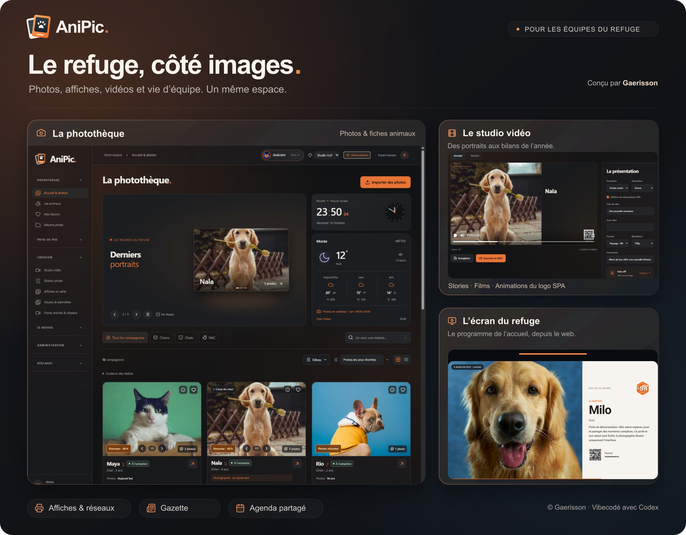

<p align="center"><strong>Photothèque, création et outils pour l’équipe du refuge.</strong></p>
<p align="center">React · Tailwind CSS · Fastify · SQLite · Sharp · Remotion · Docker</p>

Anipic reprend le projet GPIC SPA pour organiser les photos des animaux, préparer des publications et des affichettes de box, créer des vidéos et diffuser un programme sur la TV de l’accueil. Les fiches utilisent les identifiants de la SPA : deux animaux portant le même nom gardent chacun leur album.

**Projet vibecodé par [Gaerisson](https://github.com/Gaerisson/), avec Codex, assistant d’OpenAI.** L’idée, les besoins métier, les choix visuels et la direction du projet viennent de Gaerisson.

[Release 3.15.0](RELEASE_v3.15.0.md) · [Installation Docker / Portainer](docs/DEPLOIEMENT.md) · [Journal des versions](CHANGELOG.md) · [API SPA / AniPic](docs/API_ANIMAUX.md) · [Google et bénévoles](GOOGLE.md) · [Agenda partagé](docs/AGENDA.md) · [Suivi des TV](docs/SUIVI_TV.md) · [Tests et validation](VALIDATION.md)

## Présentation

**Nouveautés 3.14 :** [éditeur Canvas](docs/CANVAS.md), navigation regroupée, relecture avec corrections dans le texte, studio annuel avec portraits SPA, TV sans PIN et suppression réelle des anciennes fiches après sauvegarde.

**Installation Android :** la page `/android` fournit l’APK signée et son QR code. Le dépôt contient les sources Android et `public/downloads/AniPic-3.14.0.apk`, également livré par l’image Docker. Une fois ce projet déployé : **https://anipic.gaerisson.fr/android**.

**Android :** une [APK reliée au site](docs/ANDROID.md), avec accueil mobile, fil, planning des bénévoles, photos et C8. La version web installable depuis Chrome reste disponible. Le guide explique le déploiement du fichier d’association, les mises à jour et la signature privée.

Deux montages de **24,5 secondes**, 30 images/s : portraits en relief et présentation de la photothèque, retouche, affiches, studio et écran TV. Transitions synchronisées sur un extrait de **Borderline — Tame Impala**, fourni pour cette présentation. Le morceau d’origine reste hors du dépôt.

| Story Instagram                                               | Présentation GitHub                                             |
| ------------------------------------------------------------- | --------------------------------------------------------------- |
| [1080 × 1920 · MP4](docs/media/anipic-presentation-story.mp4) | [1920 × 1080 · MP4](docs/media/anipic-presentation-paysage.mp4) |

[Composition et reproduction du montage](PRESENTATION.md).

## Nouveautés 3.12

- Planning des bénévoles : créneaux, capacités, disponibilités et synthèse des présences par jour.
- Accueil Android utile, fil en une colonne, notifications choisies et gestion des appareils connectés.
- Mise à jour APK intégrée avec téléchargement vérifié et installateur Android ; nouvelle page de téléchargement et lien sur l’accueil.
- Modules activables, affiches publiques avec photos SPA/locales publiques et atelier de rédaction/relecture.
- Réglages individuels des TV, captures réelles du lecteur et récupération après coupure.
- Mentions, conditions et confidentialité par instance ; mesure d’audience désactivée avant consentement.

[Équipe et mobile](docs/EQUIPE_MOBILE.md) · [Confidentialité et préparation de l’instance](docs/CONFIDENTIALITE.md).

- APK Android, accueil mobile et mode hors connexion sans cache de données privées.
- Météo compacte à côté de l’horloge ; effectifs chiens/chats/NAC et progression des portraits locaux.
- Petites photos et décisions d’adoption directement dans le fil ; confirmation automatique ou après 24 h sans réponse, annulation et historique pour les agents.

- Fil d’accueil avec +/−/cœur et dates ; file « Adoptions à confirmer » pour les agents, compteur et validation sans double comptage.
- Nouveau poster en silhouette SPA, portraits regroupés dans le logo et noms toujours lisibles, exports A4/A3/A2.
- Synchronisation dès 15 minutes, reprise après échec et alerte d’écart SPA ; adoptions automatiques après confirmations, au choix de l’administration.
- Actions regroupées, jusqu’à 200 animaux par page, export CSV et corbeille des archives avec sauvegarde avant vidage.
- Photos mal attribuées : réattribution seule ou en lot, annulation Ctrl+Z et suggestions par ressemblance des portraits locaux / SPA.
- Comptes bénévoles via Google, soumis à validation, avec accès aux outils de création.
- Affiches en série avec progression et suivi des affichettes installées dans les box.
- Gazette préremplie : résumé, arrivées, adoptions et portraits, avec PDF/images et partage WhatsApp.
- Agenda partagé, dates clés et diffusion des événements sur la TV au choix.
- Suivi des TV : connexion, actualisation, séquence en cours et historique des incidents.
- Ententes nuancées en orange, thèmes clairs et placements mobiles corrigés.

[Notes de version](RELEASE_v3.15.0.md) · [Atelier du refuge](docs/ATELIER_REFUGE.md) · [Historique complet](CHANGELOG.md).

## Les espaces

| Espace         | Fonctions                                                                                                                                                                   |
| -------------- | --------------------------------------------------------------------------------------------------------------------------------------------------------------------------- |
| Photos         | Galerie 3D réglable, carrousel, dates des dernières séries, comparaison indicative avec la photo SPA, glow récent, zoom fluide, favoris et téléchargements.                 |
| Prise de vue   | Dépôt Lightroom / Photoshop, tri par séries et attribution avec ID, priorités SOS / réservés, commentaires sur image et feuille imprimable avec portraits.                  |
| Fiches         | Faits et statuts SPA, ententes avec pictogrammes, photos et vidéos, affichettes A4 / A5 en cinq styles dont Liquid glass et placement personnalisé, QR et export en série.  |
| Création       | Éditeur photo en direct, presets et réglages avancés, studio Remotion, sous-titres, voix off, Canva, visuels Facebook et fonds d’écran.                                     |
| TV             | Lien web plein écran, renouvellement des animaux, timeline par glisser-déposer et étirement, vidéos, messages saisonniers automatiques, horaires, exclusions et export MP4. |
| Vie du refuge  | Fil illustré et historique réunis, couleurs par événement, API publique, RSS, statistiques et bilan annuel animé avec formation du logo SPA.                                |
| Équipe         | Rôles administrateur / photographe / agent SPA / bénévole approuvé / lecteur, albums privés, messages avec accusé de lecture, assistant et avatar configurable.             |
| Administration | Accès PIN optionnel, connexion agent par IP, widgets d’accueil, textes par défaut, accès public/équipe par page, GeoIP local, sauvegardes et exports des paramètres.        |

## Démarrer en local

Node.js **24** pour les builds reproductibles et la CI.

```sh
npm ci
npm run build
npm run video:build
npm run video:browser
npm run preview
```

La démo s’ouvre sur `http://localhost:3036`. Son administration se lance depuis « Explorer l’administration de démo ». Elle utilise le dossier isolé `.demo/` et des profils fictifs. Une installation de production démarre vide, avec `npm run setup` puis `npm start` ; elle ne charge aucun animal de test.

## Docker et NAS

Copier `.env.example` vers `.env` et monter le NAS sur l’hôte Docker. Initialiser les dossiers avec les droits du service (aucune écriture autorisée sur un montage local de remplacement) :

```sh
sudo node scripts/prepare-storage.mjs --mount /mnt/nas --root /mnt/nas/anipic --uid 1000 --gid 1000 --with-c8 --with-import
```

Reporter les chemins affichés dans `.env` et définir `APP_ORIGIN`, puis :

```sh
docker compose -f compose.yml up -d --build
docker compose -f compose.yml exec -it anipic npm run setup
```

Le conteneur utilise un compte non root et une racine en lecture seule. SQLite et le cache restent dans des volumes locaux ; les originaux et les sauvegardes peuvent être sur le NAS. Une instance utilise la base. [Guide complet, Portainer, Apache et C8](docs/DEPLOIEMENT.md).

Trois modes sont proposés : `compose.yml` pour compiler depuis Git, `portainer-stack.yml` pour une image locale et `portainer-ghcr.yml` pour télécharger `ghcr.io/gaerisson/anipic:3.15.0` après sa publication GitHub. Conserver la stack, les volumes et les chemins NAS existants. [Procédure de mise à jour](docs/DEPLOIEMENT.md#portainer-et-apache).

La publication de l’image et de la release est déclenchée par un tag `v3.15.0` ou manuellement dans Actions → Validation Anipic, option **publish**. Elle attend les tests, les deux builds, la construction Docker, un rendu MP4 réel et la validation Android (compilation, signature et manifeste de l’APK distribuée). Au premier envoi, vérifier que le package GHCR est public. [Publication et dépannage](docs/CONTROLES_RELEASE.md).

## Configurer les services

- **SPA** : source, refuge, espèces, passages, pagination, budgets et planification depuis API & connexions. Prévisualiser avant import. Les informations d’un animal sont actualisées depuis la source.
- **Mistral** : clé, modèles de voix / transcription et voix par défaut dans API & connexions → Audio. Une clé d’environnement reste prioritaire. Les appels audio partent seulement à la demande.
- **Gemini / Token Harbor** : clés dans l’environnement ; modèles dans l’interface. Rédaction et assistant optionnels.
- **Canva** : connexion OAuth par compte et présentation éditable. [Guide Canva](CANVA.md).
- **TV** : les comptes Agent SPA et Administrateur peuvent configurer et enregistrer le programme dans Le refuge → Écran du refuge, puis ouvrir `APP_ORIGIN/#display` sur le téléviseur. Les réglages enregistrés sont relus chaque minute.
- **Visiteurs** : données accessibles aux administrateurs, IP, compte, navigateur, appareil, pages et sessions estimées. Conservation 30 jours. Géolocalisation indicative hors ligne avec DB-IP City Lite : pays, drapeau, région et ville si connus. Mise à jour MMDB depuis les paramètres ; aucune IP envoyée à un service GeoIP externe.
- **Accès** : PIN et connexion automatique d’un compte **agent** par IP désactivés initialement. Configuration depuis les paramètres, avec changement de compte toujours disponible. La TV et les pages publiques restent soumises au PIN global s’il est activé. Après déverrouillage, l’autorisation du navigateur n’expire plus côté AniPic, tant que ses cookies sont conservés (cookie persistant renouvelé lors des visites et de la diffusion TV) ; changer le PIN révoque les anciennes autorisations.
- **Accueil** : ordre et visibilité des widgets, aperçu TV, thèmes, effets et textes configurables côté serveur.

## Données et accès

Les originaux sont immuables et dédupliqués par SHA-256. Les aperçus WebP se créent à la demande sous budget de cache. Les albums et archives utilisent des références. Les téléchargements, médias privés et opérations de gestion vérifient le rôle et les droits ; les écritures authentifiées vérifient aussi le jeton CSRF et l’origine.

Une adoption dans les statistiques vient d’un statut daté ou, si l’administration active cette option, de la règle d’adoption automatique après absences confirmées. La provenance est signalée et un retour de l’animal corrige automatiquement le classement. Un simple archivage n’est pas une adoption. Les clés API, données de l’installation, comptes, photos privées et caches sont exclus du dépôt. Le fichier `.mistral-key` reste privé et hors des sauvegardes/exportations de paramètres.

```sh
npm test
npm run build
npm run video:build
```

Les essais couvrent les droits, le PIN et les IP, la confidentialité, les homonymes, les dates, les photos, les sauvegardes, la TV, les connecteurs et les échecs de publication simulés. [Résultats et limites des essais](VALIDATION.md).

## Documentation

[Importer les photos](IMPORT_PHOTOS.md) · [Médias et TV](API_MEDIAS_TV.md) · [Données SPA / I-CAD](DONNEES_ANIMAUX.md) · [Exemples d’affichettes](docs/examples) · [Nouveautés 3.0](docs/history/NOUVEAUTES_V30.md)

## Licence

Copyright © 2026 **Gaerisson**. Le code original et la documentation sont sous
**GPLv3 avec exception de liaison limitée à Remotion**. [Conditions et exception](LICENSE.md) · [Texte GPLv3](COPYING) · [Composants tiers et médias](THIRD_PARTY_NOTICES.md).
Les logos SPA, photos, musiques et bibliothèques conservent leurs propres droits.

## Crédits

Géolocalisation : [IP Geolocation by DB-IP](https://db-ip.com), base City Lite (CC BY 4.0), distribuée par [DbIP-City-lite](https://github.com/wp-statistics/DbIP-City-lite). Précision indicative ; les IP privées restent identifiées comme réseau local.

**Gaerisson** : conception, photographie, direction et projet d’origine. **Codex / OpenAI** : développement et vérifications avec Gaerisson. Logo et charte **La SPA** : éléments officiels fournis pour le refuge, conservés dans leurs proportions et couleurs. Les interfaces et modèles d’Anipic ne constituent pas une validation officielle de la SPA.

Bibliothèques : React, Tailwind CSS, Fastify, SQLite, Sharp, Remotion, Lucide, Mediabunny, PDF-lib et QRCode. Polices et licences locales conservées. Les photos de démo et leurs sources sont documentées dans `demo/`. Les références d’interaction du carrousel et des cartes sont [Edmundo](https://codepen.io/edmundojr/pen/qdLWWx), [Robin Dela](https://codepen.io/robin-dela/pen/jVddbq) et [Nicolas Pavlotsky](https://codepen.io/nicolaspavlotsky/details/wqGgLO).

Les anciennes notes sont rangées dans [docs/history](docs/history/README.md). Le logo se régénère avec `npm run brand:build` depuis une géométrie SVG commune aux variantes écran, favicon et PNG.

### Comptes bénévoles et exports en série

Les bénévoles peuvent demander un compte avec Google ; l’administrateur doit le valider avant tout accès aux outils. Le rôle donne accès aux créations photo/vidéo/affiches, albums privés, archives, statistiques et C8, sans administration ni registre interne. [Configurer Google](GOOGLE.md).

Les affiches en série se préparent en arrière-plan avec progression et rapport des erreurs. Jusqu’à 500 animaux par sélection ; un seul ZIP contient les PDF, en lots de 10 pages. Le résultat privé reste téléchargeable 24 heures et le suivi reprend au retour sur la page. Les PDF utilisent des images JPEG de qualité d’impression, au lieu d’accumuler les pages PNG très volumineuses.
