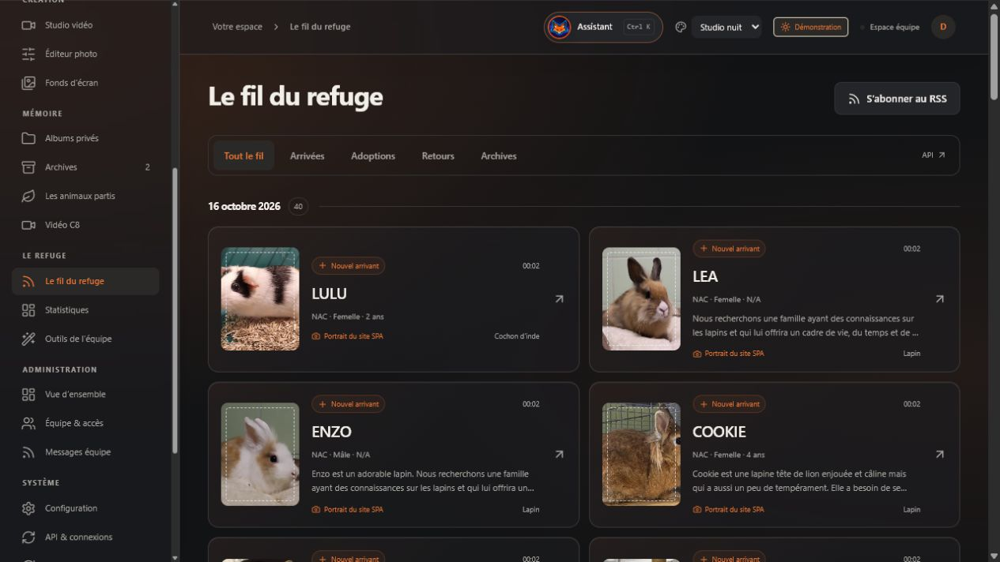

# Anipic 2.8 · L’atelier photo et vidéo du refuge

Anipic réunit les portraits des animaux, les informations provenant de la SPA et les outils privés de l’équipe. Cette version harmonise les couleurs de l’interface et ajoute un bilan annuel dont les portraits composent progressivement le logo SPA.

- Nouveau logo appareil photo et patte, fourni en SVG et PNG.
- Accents liés à la configuration, verre dépoli étendu et réglable, fenêtres et commandes réalignées.
- Références SPA en couleur, cadre pointillé et repère appareil photo.
- Fil enrichi : portrait, présentation, sexe/âge, race et origine des photos.
- Bilan annuel avec sélection des animaux, animation en mosaïque SPA et statistiques issues des observations enregistrées.
- Recherche/import musical Commons avec attribution conservée ; accès aux catalogues Pixabay et Meta.
- Projets et exports supprimables dans une corbeille restaurable.
- Générateur de fonds d’écran personnalisables, jusqu’au PNG 4K.
- Messages internes ciblés vers les agents ou comptes, expiration et lectures individuelles.
- Feuille de séance avec portraits SPA et case unique Photographié ; import GPIC déplacé dans l’administration.
- Menu organisé par usage.

Les anciens projets, les originaux et les informations SPA sont conservés. Les adoptions ne sont pas déduites de l’archivage. Les nouveaux messages et la corbeille sont inclus dans les sauvegardes de la base.

Validation locale : suite automatisée complète, compilations Vite et Remotion, parcours dans le navigateur, export PNG 2560 × 1440 et véritable rendu MP4 1280 × 720 de 26 secondes. Recherche et import d’une musique Commons également essayés sur le service réel. Les détails et limites sont dans [VALIDATION.md](../../VALIDATION.md).

Pour utiliser les nouveautés : [guide V2.8](NOUVEAUTES_V28.md). Mise en production Docker/NAS à valider sur l’hôte cible ; services authentifiés Canva/LLM/TTS à configurer avec vos identifiants. Le fichier présent est une description de release prête pour GitHub ; aucune publication distante n’a été effectuée.

**Conception et photographie : [Gaerisson](https://github.com/Gaerisson/). Développement assisté par OpenAI Codex.** Le nom et le logo SPA restent la propriété de leurs titulaires.
